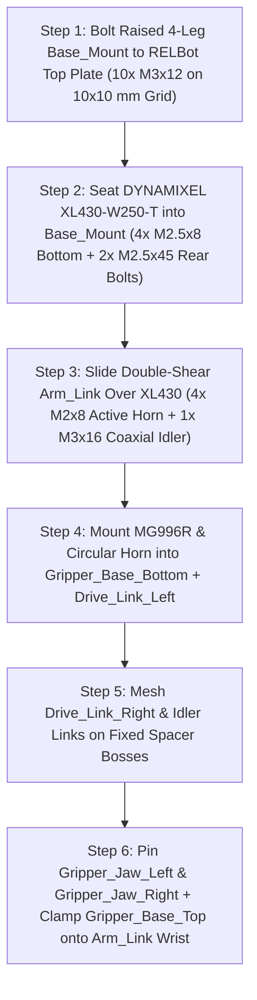

# RELBot 1-DOF Robotic Arm & Parallel-Jaw 4-Bar Gripper — Assembly & Manufacturing Guide

> [!IMPORTANT]
> **Design Revision Summary (`it1.pdf` + `Leader_SW_Render.png` + `10 × 10 mm` Uniform Grid + DYNAMIXEL XL430-W250-T Shoulder + MG996R Gripper)**
> 1. **Uniform `10 × 10 mm` Base Hole Grid (`it1.pdf`):** Anchored on the rear 2 red mounting screw pairs (`Y = -10.0, 0.0 mm` at `X = ±30.0 mm`) that fit the real physical RELBot top plate, and eliminated the `17.0 mm` CAD discontinuity by placing all front mounting holes on the uniform `10.0 mm` pitch (`Y = -50.0, -40.0, -30.0, -20.0, -10.0, 0.0 mm` at `X = ±30.0 mm`, `Ø3.4 mm` M3 clearance).
> 2. **Raised 4-Leg Box-Truss `Base_Mount` (`Leader_SW_Render.png` & `it1.pdf`):** Replaced the flat `Z = 0..5.0 mm` base plate with a hollow rectangular box-truss riser (`X = [-37.8, +37.8] mm`, `Y = [-54.5, +6.5] mm`, `Z = 0.0..50.25 mm`) standing on **4 corner legs** (`Y = -54.5..-25.5` front, `Y = -14.5..+6.5` rear):
>    - Provides **`15.8–16.65 mm`** of unobstructed central vertical clearance (`X = [-24.5, +24.5] mm`) and **`6.5–8.0 mm`** side arch clearance (`Y = -25.5..-14.5 mm`) — exceeding the `6.0 mm` minimum in [it1.pdf](file:///home/navid/Downloads/it1.pdf) so pre-installed bolts on the plate (such as flagpole holder bolts and the `(-12.34, -18.50)` standoff) never interfere.
>    - Features diagonal Warren-truss side walls (`X = ±33.4..±37.8 mm`), `4×` raised cylindrical socket-access bosses (`Ø9.2 mm`) at `(±30.0, -10.0)` and `(±30.0, 0.0)` plus front leg collars, and a dedicated underside XL430 TTL cable pass-through slot (`X = [-16.8, -10.0]`, `Y = [-28.5, -17.5] mm`).
> 3. **Robotis DYNAMIXEL XL430-W250-T Shoulder & Double-Shear `Arm_Link` (`adjustments2.pdf`):** Cradles the [Robotis_DYNAMIXEL_XL430_W250_T.STEP](file:///home/navid/Documents/Erasmus/RELBOT/RELBOT_1DOF_Arm_Gripper/Robotis_DYNAMIXEL_XL430_W250_T.STEP) actuator at `(X = 0.0, Y = -37.0, Z = 36.0 mm)` via **4× M2.5 × 8 mm bottom screws** (`X = ±6.0 mm`, `Y = -33.0, -9.0 mm`) and **2× M2.5 × 45 mm rear corner through-bolts** (`Y = -5.0 mm`, `Z = 25.0, 47.0 mm`), while `Arm_Link` straddles both sides (`+X = +19.0 mm` horn, `-X = -17.0 mm` idler) with full `-40°` to `+90°` pitch clearance.
> 4. **Dedicated MG996R Servo Fixation, Lowered Mounting Boss & Precision Involute Gear Drive (`a1.pdf` & `MG996R.pdf`):** Lowered `Gripper_Base_Bottom` underside servo boss to `Z = 13.2 mm` (`47.6 mm` mounted horn top per `MG996R.pdf` aligns coplanarly inside `Drive_Link_Left` at `Z = 29.2..35.7 mm`), added a matching hollow `Ø12.0 / Ø8.0 mm` upper retaining spacer (`Z = 36.0..43.0 mm`) on `Gripper_Base_Top`, deepened `4×` flush `Ø6.0 mm` servo counterbores (`Z = 21.2..29.0 mm` for `4× M3 × 16 mm` SHCS + locknuts), replaced the loose/truncated teeth with precision **`m = 1.5 mm, Z = 20`** involute gear sectors (`0.16 mm` total backlash, `~0.66°` play) spanning the full stroke down to **`0.0 mm` closed jaw gap**, and added curved C-arm shanks to `Drive_Link_Left/Right` that clear the `(±15, -220)` idler posts.

---

## 1. Visual Overview & CAD Views

````carousel

<!-- slide -->

<!-- slide -->

<!-- slide -->

````

---

## 2. Exported Deliverables

All files are generated by [build_relbot_1dof_arm_gripper.py](file:///home/navid/Code/freecad_gemini/build_relbot_1dof_arm_gripper.py) and saved to both `/home/navid/Documents/Erasmus/RELBOT/RELBOT_1DOF_Arm_Gripper/` and `/home/navid/Code/freecad_gemini/`:

| Component / Deliverable | RELBOT Project Folder Link | Workspace File Link | Volume ($\text{mm}^3$) | Bounding Box ($X \times Y \times Z\text{ mm}$) |
| :--- | :--- | :--- | :---: | :---: |
| **Native FreeCAD Project** | [RELBOT_1DOF_Arm_Gripper.FCStd](file:///home/navid/Documents/Erasmus/RELBOT/RELBOT_1DOF_Arm_Gripper/RELBOT_1DOF_Arm_Gripper.FCStd) | [RELBOT_1DOF_Arm_Gripper.FCStd](file:///home/navid/Code/freecad_gemini/RELBOT_1DOF_Arm_Gripper.FCStd) | — | Full Assembly + Reference Hardware |
| **Combined STEP Assembly** | [RELBOT_1DOF_Arm_Gripper.step](file:///home/navid/Documents/Erasmus/RELBOT/RELBOT_1DOF_Arm_Gripper/RELBOT_1DOF_Arm_Gripper.step) | [RELBOT_1DOF_Arm_Gripper.step](file:///home/navid/Code/freecad_gemini/RELBOT_1DOF_Arm_Gripper.step) | — | All 10 Printable Solids |
| `Base_Mount` | [Base_Mount.stl](file:///home/navid/Documents/Erasmus/RELBOT/RELBOT_1DOF_Arm_Gripper/Base_Mount.stl) | [Base_Mount.stl](file:///home/navid/Code/freecad_gemini/Base_Mount.stl) | `36,392.2` | `[-37.8, 37.8] × [-54.5, 6.5] × [0.0, 50.2]` |
| `Arm_Link` | [Arm_Link.stl](file:///home/navid/Documents/Erasmus/RELBOT/RELBOT_1DOF_Arm_Gripper/Arm_Link.stl) | [Arm_Link.stl](file:///home/navid/Code/freecad_gemini/Arm_Link.stl) | `79,684.8` | `[-27.0, 27.0] × [-158.0, -23.0] × [22.0, 50.0]` |
| `Gripper_Base_Top` | [Gripper_Base_Top.stl](file:///home/navid/Documents/Erasmus/RELBOT/RELBOT_1DOF_Arm_Gripper/Gripper_Base_Top.stl) | [Gripper_Base_Top.stl](file:///home/navid/Code/freecad_gemini/Gripper_Base_Top.stl) | `22,523.1` | `[-28.0, 28.0] × [-228.0, -142.0] × [36.0, 48.0]` |
| `Gripper_Base_Bottom` | [Gripper_Base_Bottom.stl](file:///home/navid/Documents/Erasmus/RELBOT/RELBOT_1DOF_Arm_Gripper/Gripper_Base_Bottom.stl) | [Gripper_Base_Bottom.stl](file:///home/navid/Code/freecad_gemini/Gripper_Base_Bottom.stl) | `23,776.4` | `[-28.0, 28.0] × [-228.0, -142.0] × [13.2, 36.0]` |
| `Drive_Link_Left` | [Drive_Link_Left.stl](file:///home/navid/Documents/Erasmus/RELBOT/RELBOT_1DOF_Arm_Gripper/Drive_Link_Left.stl) | [Drive_Link_Left.stl](file:///home/navid/Code/freecad_gemini/Drive_Link_Left.stl) | `5,525.1` | `[-46.2, 1.5] × [-240.2, -181.9] × [29.2, 35.7]` |
| `Drive_Link_Right` | [Drive_Link_Right.stl](file:///home/navid/Documents/Erasmus/RELBOT/RELBOT_1DOF_Arm_Gripper/Drive_Link_Right.stl) | [Drive_Link_Right.stl](file:///home/navid/Code/freecad_gemini/Drive_Link_Right.stl) | `5,588.2` | `[-1.4, 46.2] × [-240.2, -185.1] × [29.2, 35.7]` |
| `Idler_Link_Left` | [Idler_Link_Left.stl](file:///home/navid/Documents/Erasmus/RELBOT/RELBOT_1DOF_Arm_Gripper/Idler_Link_Left.stl) | [Idler_Link_Left.stl](file:///home/navid/Code/freecad_gemini/Idler_Link_Left.stl) | `3,027.7` | `[-47.0, -10.0] × [-260.8, -215.2] × [36.3, 42.8]` |
| `Idler_Link_Right` | [Idler_Link_Right.stl](file:///home/navid/Documents/Erasmus/RELBOT/RELBOT_1DOF_Arm_Gripper/Idler_Link_Right.stl) | [Idler_Link_Right.stl](file:///home/navid/Code/freecad_gemini/Idler_Link_Right.stl) | `3,027.7` | `[10.0, 47.0] × [-260.9, -215.1] × [36.3, 42.8]` |
| `Gripper_Jaw_Left` | [Gripper_Jaw_Left.stl](file:///home/navid/Documents/Erasmus/RELBOT/RELBOT_1DOF_Arm_Gripper/Gripper_Jaw_Left.stl) | [Gripper_Jaw_Left.stl](file:///home/navid/Code/freecad_gemini/Gripper_Jaw_Left.stl) | `15,784.9` | `[-50.5, -27.0] × [-306.0, -229.0] × [24.0, 48.0]` |
| `Gripper_Jaw_Right` | [Gripper_Jaw_Right.stl](file:///home/navid/Documents/Erasmus/RELBOT/RELBOT_1DOF_Arm_Gripper/Gripper_Jaw_Right.stl) | [Gripper_Jaw_Right.stl](file:///home/navid/Code/freecad_gemini/Gripper_Jaw_Right.stl) | `15,784.9` | `[27.0, 50.5] × [-306.0, -229.0] × [24.0, 48.0]` |

---

## 3. Bill of Materials (BOM)

### 3.1 Actuators & Off-the-Shelf Hardware
| Qty | Item | Specification / Role | Mounting Location |
| :---: | :--- | :--- | :--- |
| **1** | **Robotis DYNAMIXEL XL430-W250-T** | Smart Actuator (`28.5 × 46.5 × 34.0 mm`), active horn (`+X = +19.0 mm`, `Ø16.0 mm` BCD) & coaxial passive idler (`-X = -17.0 mm`) | Shoulder Pitch Joint (`Y = -37.0, Z = 36.0 mm`) |
| **1** | **TowerPro MG996R Servo + 1-Arm Horn** | Standard `40.7 × 19.7 × 42.9 mm` actuator + 1-arm horn (or trimmed 2-arm horn, `47.6 mm` top height per [MG996R.pdf](file:///home/navid/Documents/Erasmus/RELBOT/RELBOT_1DOF_Arm_Gripper/MG996R.pdf)) | Gripper Drive Pivot (`X = -15.0, Y = -200.0 mm`) |
| **10** | **M3 × 12 mm Socket Head Cap Screws + M3 Nuts** | Bolts `Base_Mount` 4 corner legs to RELBot Top Acrylic Plate (`10 × 10 mm` uniform grid) | `X = ±30.0 mm`, `Y = -50, -40, -30, -10, 0 mm` (optional `Y = -20 mm` with 8 mm spacer) |
| **4** | **M2.5 × 8 mm Socket Head Cap Screws** | Threads upward through `Base_Mount` raised deck (`Z = 17.65 mm`) into XL430 bottom M2.5 tapped holes | `X = ±6.0 mm`, `Y = -33.0, -9.0 mm` (`Z = 17.65 → 21.75 mm`, `3.9 mm` thread engagement) |
| **2** | **M2.5 × 45 mm Socket Head Cap Screws + M2.5 Locknuts** | Rear lateral through-bolts clamping `Base_Mount` side ears across the XL430 rear corner bores | `Y = -5.0 mm`, `Z = 25.0, 47.0 mm` (`X = -22.0 ↔ +22.0 mm`) |
| **4** | **M2 × 8 mm Socket Head Cap Screws** | Bolts `Arm_Link` right cheek (`+X`) directly to DYNAMIXEL XL430-W250-T active horn (`Ø16.0 mm` bolt circle) | `X = +27.0 → +19.0 mm`, `(Y, Z) = (-37 ± 8, 36)` & `(-37, 36 ± 8)` |
| **1** | **M3 × 16 mm Button/Socket Head Screw + M3 Nut** | Coaxial passive idler support bolt through `Arm_Link` left cheek (`-X`) into XL430 rear idler bearing (`Ø3.0 mm` bore) | `X = -27.0 → -17.0 mm`, `(Y = -37.0, Z = 36.0 mm)` |
| **4** | **M3 × 16 mm Socket Head Cap Screws + M3 Locknuts** | Recessed flush in `Gripper_Base_Bottom` (`Z = 21.2..29.0 mm` counterbores) clamping the MG996R flange (`Z = 10.7..13.2 mm`) | `X = -20.0, -10.0 mm`, `Y = -214.0, -165.5 mm` |
| **1** | **M4 × 8 mm (or M3 × 8 mm) Servo Horn Center Screw** | Passed through `Drive_Link_Left` `Ø7.8 mm` counterbore (`Z = 33.1..35.7 mm`) & `Ø4.2 mm` bore into the MG996R output shaft | `(X = -15.0, Y = -200.0 mm)` |
| **4** | **M3 × 25 mm Screws + M3 Hex Nuts** | Rigidly clamps `Arm_Link` distal tongue (`Y = -142..-158 mm`) between `Gripper_Base_Top` and `Gripper_Base_Bottom` | `X = ±16.0 mm`, `Y = -146.0, -154.0 mm` |
| **3** | **M3 × 25 mm Shoulder/Cap Screws + M3 Nuts** | Fixed 4-bar linkage pivots (`Drive_Link_Right` + `Idler_Link_Left` + `Idler_Link_Right`) | `(+15, -200)`, `(-15, -220)`, `(+15, -220) mm` |
| **4** | **M3 × 25 mm Shoulder/Cap Screws + M3 Nuts** | Moving 4-bar jaw clevis pins (`Gripper_Jaw_Left` & `Gripper_Jaw_Right`) | `(±42.0, -236.0)` & `(±42.0, -256.0) mm` |

---

## 4. Recommended 3D Printing Parameters

> [!TIP]
> **Material & Orientation**
> - **Material:** **PETG** or **PLA+/Tough PLA** (`Arm_Link`, `Base_Mount`, `Gripper_Base_Top/Bottom`, `Drive_Link_Left/Right`, `Idler_Link_Left/Right`), plus optional **95A TPU** high-friction pads or dual-material tips on `Gripper_Jaw_Left/Right`.
> - **Layer Height:** `0.20 mm` (`0.16 mm` recommended for `Drive_Link_Left` and `Drive_Link_Right` to ensure crisp `m = 1.5 mm` involute gear tooth meshing).
> - **Perimeters / Walls:** `4 perimeters` (`1.6 mm` shell thickness) and `25%–35% gyroid infill`.

---

## 5. Step-by-Step Assembly Sequence



### Step 1 — Install Raised `Base_Mount` onto the RELBot Top Acrylic Deck
1. Align the 10 leg through-holes (`Ø3.4 mm`) of [Base_Mount.stl](file:///home/navid/Documents/Erasmus/RELBOT/RELBOT_1DOF_Arm_Gripper/Base_Mount.stl) with the real RELBot top acrylic plate's uniform `10 × 10 mm` grid (`X = ±30.0 mm`, `Y = -50.0, -40.0, -30.0, -10.0, 0.0 mm`; optional `Y = -20.0 mm` holes are also provided in the `Z = 8.0..12.5 mm` raised side bridge).
2. Confirm that the `15.8–16.65 mm` open central tunnel (`X = [-24.5, +24.5] mm`) and `6.5–8.0 mm` side arches clear all existing plate hardware (flagpole holder bolts, standoffs, etc.) without contact.
3. Fasten using **10× M3 × 12 mm screws** and M3 nuts underneath the acrylic deck — inserting the rear screws (`Y = -10.0, 0.0 mm`) and `Y = -30.0 mm` screws through the `Ø6.0 mm` vertical hex-driver access ports on the top deck.

### Step 2 — Mount the Robotis DYNAMIXEL XL430-W250-T Shoulder Actuator
1. Thread **4× M2.5 × 8 mm socket head screws** upward through the open `15.8 mm` underside tunnel into the shallow counterbores (`X = ±6.0 mm`, `Y = -33.0, -9.0 mm`, `Z = 17.65 mm`) and into the 4 bottom M2.5 tapped holes of the XL430 housing (`Z = 21.75 mm`). Route the XL430 bottom 3-pin TTL cable cleanly through the `X = [-16.8, -10.0], Y = [-28.5, -17.5] mm` pass-through slot.
2. Insert **2× M2.5 × 45 mm cross-bolts** through the rear clamping ears of `Base_Mount` (`Y = -5.0 mm`, `Z = 25.0 mm` and `47.0 mm`) and secure with M2.5 locknuts. The front half of the XL430 (`Y = -48.25..-18.0 mm`) remains completely unobstructed for the wide double-shear `Arm_Link` clevis.

### Step 3 — Attach the Reinforced Double-Shear `Arm_Link` to the DYNAMIXEL XL430-W250-T
1. Slide the double-shear clevis ears (`X = -27.0..-19.1 mm` and `+19.1..+27.0 mm`) of [Arm_Link.stl](file:///home/navid/Code/freecad_gemini/Arm_Link.stl) over the front of the DYNAMIXEL XL430-W250-T so the inner `Ø8.4 mm` boss recess on the right cheek seats over the XL430 active horn center boss (`X = +19.0..+20.9 mm`) and the integral `Ø14.0 mm` coaxial step on the left cheek seats against the XL430 passive idler bearing (`X = -17.0 mm`).
2. Fasten the right cheek (`+X`) to the XL430 active horn using **4× M2 × 8 mm socket head cap screws** on the `Ø16.0 mm` bolt circle (`(Y, Z) = (-45, 36), (-29, 36), (-37, 28), (-37, 44) mm`).
3. Insert **1× M3 × 16 mm screw** through the left cheek (`-X`) coaxial bore at `(Y = -37.0, Z = 36.0 mm)` into the XL430 passive idler bearing to lock the shoulder in true double-shear.

### Step 4 — Mount the MG996R Gripper Servo & `Drive_Link_Left`
1. Insert the **MG996R servo** upward from below through the rectangular pocket of [Gripper_Base_Bottom.stl](file:///home/navid/Documents/Erasmus/RELBOT/RELBOT_1DOF_Arm_Gripper/Gripper_Base_Bottom.stl) until its mounting tabs (`Z = 10.7..13.2 mm`) seat **flush (`0.0 mm` gap)** against the `Z = 13.2 mm` underside boss of `Gripper_Base_Bottom`.
2. Drop **4× M3 × 16 mm socket head cap screws** into the 4 deepened `Ø6.0 mm` counterbores on `Gripper_Base_Bottom` (`X = -20.0, -10.0 mm`, `Y = -214.0, -165.5 mm`, `Z = 21.2..29.0 mm`) and thread **4× M3 locknuts** onto the protruding shafts underneath the MG996R flange (`Z = 8.3..10.7 mm`). The recessed screw heads sit completely below `Z = 29.0 mm` so `Drive_Link_Left` (`Z = 29.2..35.7 mm`) sweeps freely above them, and the rear two screws can also be accessed through the 2× `Ø6.0 mm` top holes in `Gripper_Base_Top`.
3. Press the **MG996R 1-arm horn** (or a 2-arm horn with the opposite arm trimmed to `R <= 5.0 mm`) into the `2.5 mm`-deep underside pocket (`+125°` arm + `Ø10.3 mm` hub, `Z = 29.2..31.7 mm`) of [Drive_Link_Left.stl](file:///home/navid/Documents/Erasmus/RELBOT/RELBOT_1DOF_Arm_Gripper/Drive_Link_Left.stl), seat it onto the MG996R spline at `(X = -15.0, Y = -200.0 mm)` so `Drive_Link_Left` sits coplanar (`Z = 29.2..35.7 mm`) with `Drive_Link_Right`, and tighten the **M4 × 8 mm (or M3 × 8 mm) center horn screw** inside the `Ø7.8 mm` counterbore (`Z = 33.1..35.7 mm`) through the `Ø8.0 mm` access hole in `Gripper_Base_Top`.

### Step 5 — Assemble the 4-Bar Synchronizer Gears, Idler Links & Parallel Jaws
1. Seat [Drive_Link_Right.stl](file:///home/navid/Documents/Erasmus/RELBOT/RELBOT_1DOF_Arm_Gripper/Drive_Link_Right.stl) at `(X = +15.0, Y = -200.0 mm)` (`Z = 29.2..35.7 mm`) so its 7-tooth (`m = 1.5 mm`, `Z = 20`) involute gear sector meshes cleanly with `Drive_Link_Left`'s 6-tooth sector across the full stroke (`70.8 mm` open to `0.0 mm` fully closed) while both curved C-arms clear the `(±15.0, -220.0)` spacer bosses.
2. Place [Idler_Link_Left.stl](file:///home/navid/Documents/Erasmus/RELBOT/RELBOT_1DOF_Arm_Gripper/Idler_Link_Left.stl) and [Idler_Link_Right.stl](file:///home/navid/Documents/Erasmus/RELBOT/RELBOT_1DOF_Arm_Gripper/Idler_Link_Right.stl) onto the `7.0 mm`-tall integral lower spacer bosses at `(X = ±15.0, Y = -220.0 mm)` (`Z = 36.3..42.8 mm`).
3. Slide the clevis slots (`Z = 29.0..43.0 mm`) of [Gripper_Jaw_Left.stl](file:///home/navid/Documents/Erasmus/RELBOT/RELBOT_1DOF_Arm_Gripper/Gripper_Jaw_Left.stl) and [Gripper_Jaw_Right.stl](file:///home/navid/Documents/Erasmus/RELBOT/RELBOT_1DOF_Arm_Gripper/Gripper_Jaw_Right.stl) over the distal ends of the drive and idler links, and insert **4× M3 × 25 mm screws** through `(±42.0, -236.0)` and `(±42.0, -256.0) mm` into the underside M3 hex nut traps.

### Step 6 — Close the Wrist & Linkage Sandwich with `Gripper_Base_Top`
1. Seat the `14.0 mm`-thick distal wrist tongue (`Y = -142.0..-158.0 mm`, `Z = 29.0..43.0 mm`) of `Arm_Link` onto `Gripper_Base_Bottom`, routing the MG996R servo cable through the 3 integrated tie-down loops along the `Arm_Link` boom.
2. Place [Gripper_Base_Top.stl](file:///home/navid/Documents/Erasmus/RELBOT/RELBOT_1DOF_Arm_Gripper/Gripper_Base_Top.stl) (`Z = 43.0..48.0 mm`) on top so its `Ø9.0 mm` right spacer boss (`Z = 36.0..43.0 mm`) rests above `Drive_Link_Right` at `(+15.0, -200.0 mm)` and its hollow `Ø12.0 / Ø8.0 mm` retaining collar (`Z = 36.0..43.0 mm`) rests above `Drive_Link_Left` at `(-15.0, -200.0 mm)`.
3. Fasten the **4× M3 × 25 mm wrist bolts** (`X = ±16.0 mm`, `Y = -146.0, -154.0 mm`) and the **3× M3 × 25 mm fixed pivot bolts** (`(+15, -200)`, `(-15, -220)`, `(+15, -220) mm`) into the underside M3 hex nut traps.
